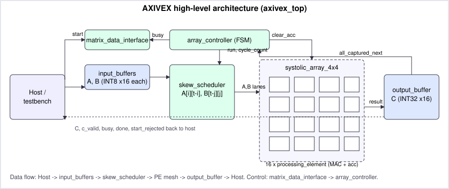
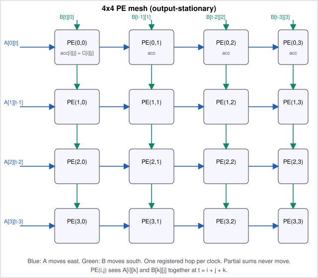

# AXIVEX

**Parallel Intelligence. Engineered in Hardware.**

AXIVEX: a modular 4x4 systolic-array accelerator for matrix multiplication. Synthesizable Verilog RTL,
self-checking SystemVerilog testbenches, an independent Python reference, a browser Digital Twin, and open-source
(Yosys) plus Vivado synthesis flows. Phase I status: **RTL verified in simulation; Yosys resource mapping done; Vivado timing not yet run.**



## What it does

`C(4x4, INT32) = A(4x4, INT8) x B(4x4, INT8)` on 16 processing elements, output-stationary:
A moves east, B moves south through registered links, each PE keeps its own accumulator.
PE(i,j) sees `A[i][k]` and `B[k][j]` at cycle `i+j+k`; a job takes **13 cycles start-to-done** (1 load + 1 clear + 10 compute + 1 retire),
64 MACs in the 10-cycle compute window.



Problem: a single-MAC engine needs 64 sequential MAC cycles for a 4x4x4 product; a systolic array overlaps them across 16 PEs with
local accumulation. (The 6.4x compute-only ratio is against a modelled, not implemented, baseline and is not area-normalised.)

## Repository layout

| Path | Contents |
|---|---|
| `rtl/` | 9 synthesizable modules (`axivex_top`, `processing_element`, `mac_unit`, `systolic_array_4x4`, `input_buffers`, `skew_scheduler`, `array_controller`, `output_buffer`, `matrix_data_interface`) |
| `tb/` | SystemVerilog testbenches (MAC, PE, output buffer, array, top) |
| `reference/` | Python golden model, vector generator, RTL comparison script, committed RTL fixtures |
| `digital-twin/` | React + TypeScript + Vite simulator; engine in `src/engine`, Vitest tests in `src/tests` |
| `scripts/` | simulation, lint, Yosys, Vivado Tcl, performance report, VCD inspection, mutation test |
| `constraints/` | reference XDC (clock only, no pin assignments) |
| `docs/` | architecture, microarchitecture, verification, development plan inputs, IEEE report (LaTeX + PDF), demo script |
| `reports/` | simulation logs, waveforms, Yosys synthesis/utilization, benchmarks, timing (pending) |

## Tool installation

macOS (Homebrew): `brew install icarus-verilog verilator yosys gtkwave node python3` (GTKWave on recent macOS may need a maintained build;
the VCD can also be opened on Linux/Windows). Ubuntu: `sudo apt install iverilog verilator yosys gtkwave nodejs npm python3`.
Phase I results were produced with Icarus Verilog 12.0, Verilator 5.020, Yosys 0.33 and Node 22 on Ubuntu 24.04.
**AMD Vivado does not run on macOS**; use Windows or a supported Linux machine (free Basic tier; check AMD UG973 for current OS/license terms).

## Run it

```bash
make test           # python + mac + pe + outbuf + array + top (directed+scenarios) + random + lint
make test-mac       # make test-pe | test-array | test-top | test-random | lint
make wave           # writes reports/waveforms/axivex_directed.vcd; open: gtkwave reports/waveforms/axivex_directed.vcd reports/waveforms/axivex.gtkw
make synth          # Yosys generic + xc7 mapping -> reports/synthesis, reports/utilization
make bench          # reports/benchmarks/performance.md from measured RTL output
make mutation       # inject 19 bugs, confirm the suite fails
make fixtures       # refresh RTL traces used by the Digital Twin tests

cd digital-twin
npm install
npm run dev         # open the printed URL
npm run test        # 25 tests, incl. comparison with the RTL trace
npm run build
```

Vivado (Windows/Linux only): `vivado -mode batch -source scripts/vivado/synth_impl.tcl` (`PART`, `CLK_PERIOD_NS` configurable).

## Interface (summary)

`clk, rst_n (sync, active low), start (rising edge), a_flat[127:0], b_flat[127:0] -> busy, done (1-cycle), c_flat[511:0], c_valid, start_rejected, result_error`.
Packing is row-major, element (i,j) at `i*4+j`: `A[i][k] = a_flat[(i*4+k)*8 +: 8]`, `C[i][j] = c_flat[(i*4+j)*32 +: 32]`. Details: `docs/architecture/architecture.md`.

## Phase I results (all reproducible with the commands above)

| Check | Result |
|---|---|
| MAC exhaustive | 393,218 checks, 0 errors |
| PE / output buffer / array | 42 checks / 0 errors / 77 jobs, 20,944 checks, all pass |
| Top directed + scenarios | 35 jobs pass (reset in 5 states, busy start, back-to-back, held start) |
| Top random | 128 seeded jobs (seed 20261116) match Python |
| Mutation check | 18/18 non-equivalent mutants killed (1 equivalent, documented) |
| Verilator lint | clean |
| Digital Twin | 25 tests pass; engine reproduces every traced field of 21 RTL jobs |
| Latency (measured) | 13 cycles start-to-done; RUN 10; 64 MACs; 40 % PE utilization in RUN, 30.8 % start-to-done |
| Yosys xc7 (flattened) | 16 DSP48E1, 1399 FDRE, 202 LUT2-6, 6 CARRY4 (Yosys, not Vivado) |

CI (`.github/workflows/ci.yml`) runs the RTL tests, lint, Yosys and the Digital Twin tests/build on GitHub Actions; it has not run yet because the repository has not been pushed.
Add a CI badge after the first successful run.

## Performance methodology

Cycle counts come from the testbench (`state` counts, MAC events) and are written to `build/directed_rtl.txt`; `scripts/perf_report.py` derives
`reports/benchmarks/performance.md`. Each metric is labelled MEASURED, MODELLED or ARCHITECTURE. No MAC/s figure is given because no clock frequency has been measured.

## Limitations

Fixed 4x4, K=4; 259-in/517-out packed ports do not fit the pins of the reference part (out-of-context synthesis only); no backpressure;
no Vivado timing/Fmax/power; baseline modelled; Digital Twin UI checked via jsdom tests and a dev-server smoke test, not by eye in a browser
in the build environment; GTKWave save file untested in the GUI.

## License

MIT (`LICENSE`).
