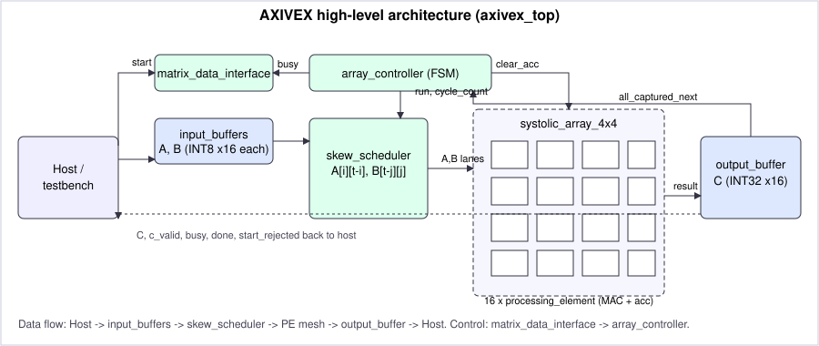
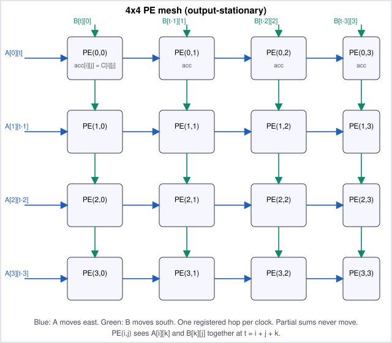

# AXIVEX architecture (Phase I)



AXIVEX computes `C(4x4, INT32) = A(4x4, INT8) x B(4x4, INT8)` on a 4x4 output-stationary systolic array.
This document is the contract that the RTL (`rtl/`), the testbenches (`tb/`), the Python reference
(`reference/`) and the Digital Twin (`digital-twin/src/engine/`) all follow.

## 1. Top-level interface (`axivex_top`)

| Port | Dir | Width | Meaning |
|---|---|---|---|
| `clk` | in | 1 | single clock domain |
| `rst_n` | in | 1 | **synchronous**, active low; hold for at least one clock edge |
| `start` | in | 1 | rising edge while `busy=0` accepts a job |
| `a_flat` | in | 128 | A, 16 x signed INT8, row-major |
| `b_flat` | in | 128 | B, 16 x signed INT8, row-major |
| `busy` | out | 1 | high in CLEAR, RUN, RETIRE |
| `done` | out | 1 | one-cycle pulse (state DONE); `busy` is low in that cycle |
| `c_flat` | out | 512 | C, 16 x signed INT32, row-major |
| `c_valid` | out | 1 | all 16 results captured; set with `done`, held until next accepted start or reset |
| `start_rejected` | out | 1 | one-cycle pulse: a start rising edge arrived while `busy` and was ignored |
| `result_error` | out | 1 | sticky: output buffer saw a duplicate PE result (must stay 0) |

### Packing (row-major, `index(i,j) = i*4 + j`)

```verilog
A[i][k] = a_flat[(i*4+k)*8  +: 8 ]    // signed
B[k][j] = b_flat[(k*4+j)*8  +: 8 ]    // signed
C[i][j] = c_flat[(i*4+j)*32 +: 32]    // signed
```

Flat vectors are used instead of unpacked array ports so every simulator and synthesis tool accepts the interface.

### Protocol rules

* `a_flat`/`b_flat` are latched on the clock edge that accepts `start`; they may change afterwards (tested).
* `start` is **edge-sensitive**. Holding it high does not retrigger (tested). A rising edge in the `DONE` cycle is accepted (`busy=0`), giving back-to-back jobs.
* A start while `busy` is dropped and flagged with `start_rejected`; the running job is unaffected (tested).
* Accepting a start clears the output buffer, so `c_valid` drops in the same cycle `busy` rises.
* Reset during any state returns to IDLE, clears accumulators, forwarding pipelines, buffers and `c_valid` (tested in CLEAR, RUN at two points, RETIRE and IDLE).

## 2. Dataflow and schedule

With `t` = `cycle_count` (0 = first RUN cycle) and K = 4:

* Row *i* presents `A[i][t-i]` for `0 <= t-i < K`; column *j* presents `B[t-j][j]` for `0 <= t-j < K`.
* A moves east and B moves south, one registered hop per clock. PE(i,j) therefore sees `A[i][k]` and `B[k][j]` together at `t = i + j + k`.
* The `last` flag (k = K-1) travels with each operand. A PE writes `result` and pulses `result_valid` when both `last` flags arrive with valid operands, i.e. after its MAC at `t = K-1+i+j`; the pulse is visible in the following cycle.
* Partial sums never move (output-stationary): PE(i,j) owns `C[i][j]`.



## 3. Controller and cycle accounting

`IDLE -> CLEAR -> RUN -> RETIRE -> DONE -> (IDLE | CLEAR)`

| Phase | State | Cycles | Notes |
|---|---|---:|---|
| Input load | (IDLE/DONE, start cycle) | 1 | A, B latched at the accepting edge |
| Accumulator clear | CLEAR | 1 | `clear_acc` zeroes all 16 PEs |
| Fill + compute + drain | RUN | 10 = K+M+N-2 | `cycle_count` 0..9; fill 3, drain 3 (M+N-2 = 6 overhead cycles beyond the ideal 4) |
| Output retirement | RETIRE | 1 | last PE (3,3) `result_valid` pulses here; output buffer captures |
| Completion | DONE | 1 | `done` pulse, `c_valid` high |

Start-to-done latency (cycle index of the DONE cycle, start cycle = 0) is **13** cycles. These four numbers
(1 + 1 + 10 + 1) are measured by the testbench in every transaction and reproduced by the Digital Twin;
they are not mixed in the reports. The compute window (RUN) is 10 cycles for 64 MACs: 40 % PE utilization
over RUN, 30.8 % over start-to-done (see `reports/benchmarks/performance.md`).

Per-PE completion cycles (RUN `cycle_count` of the last MAC, `i+j+3`) form anti-diagonals: 3 | 4 | 5 | 6 | 7 | 8 | 9
with 1,2,3,4,3,2,1 PEs; the output buffer therefore captures several results in one cycle.

## 4. Arithmetic

* Operands: signed two's complement INT8. Product: signed 16 bit (exact). Accumulator: signed 32 bit, sign-extended addition, no truncation.
* Max |C| for K=4 is 4 x 128 x 128 = 65 536, far inside INT32. The parameter `ACC_W` must stay > `2*DATA_W` (the explicit sign extension needs a non-zero width).
* The final result is `acc + current product` (computed from `acc_next`), so the last term is never dropped (mutation-tested).

## 5. Design decisions

| Decision | Reason |
|---|---|
| Output-stationary | one accumulator per PE, simple result mapping, easy to defend |
| Synchronous active-low reset | one consistent policy; maps to FDRE on Xilinx 7-series |
| Registered operand forwarding in every PE | limits combinational depth to one MAC per cycle |
| Combinational scheduler from the cycle counter | simplest correct schedule; the counter -> mux -> multiplier path is a candidate for registering in Phase II (not measured: no timing tool run) |
| Flat packed ports | portable; but 259 inputs / 517 outputs cannot be pin-mapped to the reference part (see limitations) |
| No internal stalls during RUN | fixed latency; backpressure is Phase II |

## 6. Limitations (Phase I)

* Fixed 4x4, K = 4; constants (`LAST_CYCLE`, 2-bit `k`) are hard-coded.
* The packed interface exceeds the user I/O of an xc7a35tcpg236-1; synthesis/implementation must be out-of-context. A board demo needs a narrower interface (Phase II).
* No Vivado run was possible in the Phase I environment: no Vivado timing, Fmax or power exists. Yosys results are resource counts only.
* Retirement has no watchdog: a faulty array that never produced all 16 results would leave the controller in RETIRE (testbenches have global timeouts).
